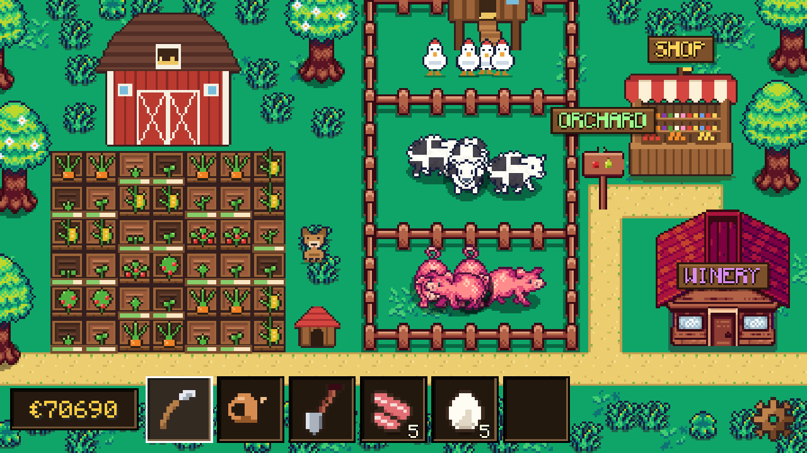
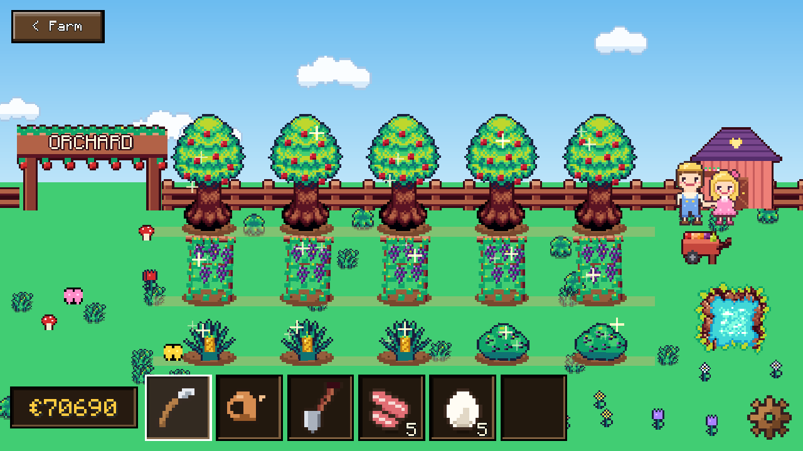
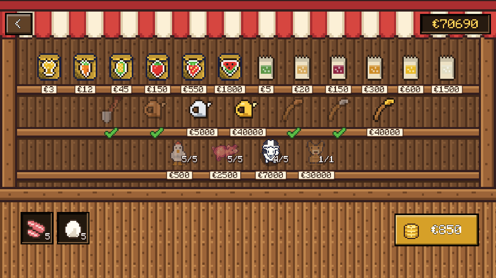
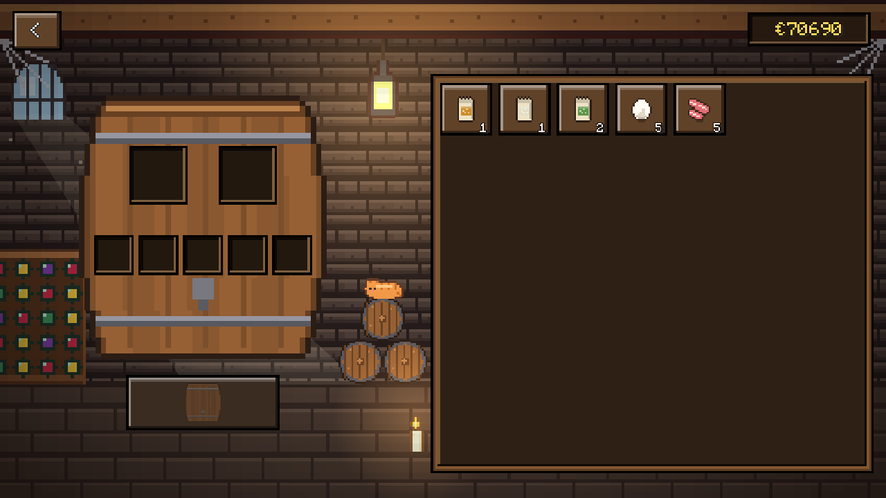

# Farming

A cosy pixel-art farming game made in Godot. **[Play in the browser](https://michalkassa.github.io/farming-with-bianca/)**

**Farm:** till, plant, water and harvest carrots, corn, wheat, tomatoes, strawberries and watermelons.

**Animals:** keep chickens, pigs and cows for eggs, bacon and milk. A dog makes everything grow faster.

**Shop:** sell your harvest, then buy seeds, animals and better tools.

**Orchard:** plant fruit trees, vines and bushes that keep fruiting.

**Winery:** mix fruit and yeast in a barrel to find new wines. Each bottle gives you a buff.

| Orchard | Shop | Winery |
|---|---|---|
|  |  |  |

Your farm saves automatically, in the browser too.

## Run it

Open the folder in Godot 4.7 and press Play. `./export_web.sh` builds the web version.
